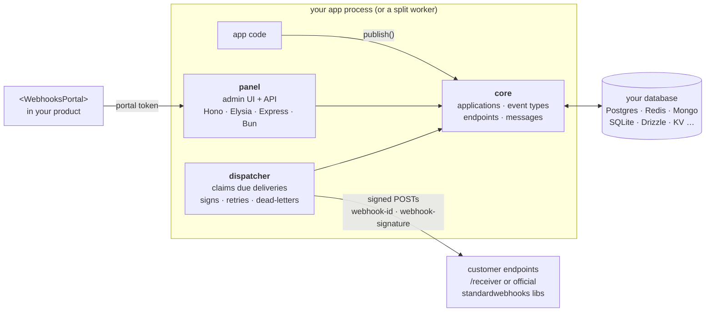

{/* The home page: written for the site; its content follows the root README.
scripts/sync.ts replaces the BASE, REPO and NPM tokens. */}

import { Card, CardGrid, LinkCard, Tabs, TabItem } from "@astrojs/starlight/components";

```sh
npm install @xtandard/webhooks
```

A Svix alternative as a library: no per-message SaaS pricing and no separate service to operate.
Your app publishes, a dispatcher inside your process (or a worker running the same library)
delivers, and your customers manage their own endpoints through an embeddable portal. The wire
contract is [Standard Webhooks](https://www.standardwebhooks.com), so receivers verify with the
official libraries in any language.

## A quick taste

<Tabs syncKey="home-taste">
<TabItem label="Mount">

```ts
import { Hono } from "hono";
import { webhooksPanel } from "@xtandard/webhooks/hono";
import { createPostgresStorage } from "@xtandard/webhooks/storage/postgres";

// The admin UI + API, and an in-process dispatcher (`dispatcher: false` for a split worker).
const webhooks = webhooksPanel({
  storage: createPostgresStorage({ connectionString: process.env.DATABASE_URL }),
});

const app = new Hono();
app.route("/webhooks", webhooks);
```

Adapters for Hono, Elysia (1 and 2), Express and Bun; storage on Postgres, Redis, MongoDB, SQLite,
libSQL, Drizzle, unstorage, Cloudflare KV, files or memory. [Quickstart →](@BASE@/guides/quickstart/)

</TabItem>
<TabItem label="Publish">

```ts
const { core } = webhooks;

await core.createApplication({ key: "acme" }); // your customer
await core.upsertEventType({ name: "invoice.paid" }); // the catalog
await core.createEndpoint("acme", {
  url: "https://api.acme-customer.com/webhooks", // their receiver
  eventTypes: ["invoice.paid"],
});

// The hot path: one write + fan-out, no HTTP, never throws because an endpoint is down.
await core.publish("acme", {
  eventType: "invoice.paid",
  payload: { invoiceId: "inv_123", amount: 4200 },
  idempotencyKey: "invoice-paid-inv_123", // safe to call twice
});
```

The dispatcher signs each delivery, retries on a schedule (5s, 5m, 30m, 2h, 5h, 10h) and
dead-letters what never succeeds. [Delivery & retries →](@BASE@/concepts/delivery/)

</TabItem>
<TabItem label="Verify">

```ts
import { verifyWebhook } from "@xtandard/webhooks/receiver";

export default async function handler(request: Request) {
  const event = await verifyWebhook(request, process.env.WEBHOOK_SECRET!); // throws if invalid
  // event.type === "invoice.paid", event.data === { invoiceId, amount }
  return new Response("ok");
}
```

Zero dependencies, any WinterCG runtime, and it verifies **any** Standard Webhooks sender. Python,
Go, Ruby, Java, Rust and PHP receivers use the official `standardwebhooks` libraries unmodified.
[Signing & verification →](@BASE@/concepts/signing/)

</TabItem>
<TabItem label="Portal">

```tsx
// Your server, after your own auth:
import { createPortalToken } from "@xtandard/webhooks";
const token = await createPortalToken(process.env.PORTAL_SECRET!, customer.appKey);

// Your React frontend:
import { WebhooksPortal } from "@xtandard/webhooks/react";
import "@xtandard/webhooks/react/styles.css";

<WebhooksPortal apiBaseUrl="/webhooks" token={token} />;
```

Customers manage their own endpoints and inspect their own deliveries inside your product, scoped
by a signed token: no sessions, no proxy routes. [Consumer portal →](@BASE@/ui/portal/)

</TabItem>
<TabItem label="Test">

```ts
import { createTestWebhooks, createTestReceiver, drainDeliveries } from "@xtandard/webhooks/testing";

const { core, dispatcher } = createTestWebhooks(); // in memory, dispatcher not started
await core.createApplication({ key: "acme" });
await core.upsertEventType({ name: "order.shipped" });
const endpoint = await core.createEndpoint("acme", { url: "http://127.0.0.1:9/tmp" });
const secret = (await core.getSecrets("acme", endpoint.id))[0]!.secret;

const receiver = await createTestReceiver({ secret, failFirst: 1 }); // exercise a retry
await core.updateEndpoint("acme", endpoint.id, { url: receiver.url });

await core.publish("acme", { eventType: "order.shipped", payload: { orderId: "o_1" } });
await drainDeliveries(dispatcher); // no timers, no sleeps

receiver.received[0]?.type; // "order.shipped", signature verified
await receiver.close();
```

A verifying local receiver and a deterministic `tick()`-driven dispatcher for your test suite.
[Testing →](@BASE@/operations/testing/)

</TabItem>
</Tabs>

## How it fits together



`publish()` is one message write plus fan-out: it never makes an HTTP call. The dispatcher owns all
network I/O; leases make it crash-safe and safe to run on several instances, with at-least-once
delivery (receivers dedupe on `webhook-id`). Unmount the admin UI and delivery keeps working.
[Architecture →](@BASE@/concepts/architecture/)

## Why @xtandard/webhooks

<CardGrid>
  <Card title="A library, not a service" icon="puzzle">
    `bun add` and the database you already have. No second deployment with its own Postgres and
    Redis to operate, and no per-message pricing.
  </Card>
  <Card title="Standard Webhooks on the wire" icon="approve-check">
    HMAC-SHA256 `v1` signatures, `webhook-id`/`webhook-timestamp` headers and zero-downtime secret
    rotation, so receivers need nothing bespoke.
  </Card>
  <Card title="Never silently drops" icon="warning">
    Exponential retries with jitter, dead-letters with per-attempt HTTP detail, replay one at a
    time or in bulk, and auto-disable for endpoints that keep failing.
  </Card>
  <Card title="Self-serve for your customers" icon="open-book">
    An embeddable portal, an admin dashboard, auth and role-based authorization, audit-ready hooks
    and a CLI with a local inspecting receiver.
  </Card>
</CardGrid>

## Guides

<CardGrid>
  <LinkCard
    title="Getting started"
    href="@BASE@/getting-started/"
    description="Install, mount the panel, create an endpoint, publish and verify in five steps."
  />
  <LinkCard
    title="Delivery & retries"
    href="@BASE@/concepts/delivery/"
    description="The lifecycle, the retry schedule, claiming, replay and the endpoint failure policy."
  />
  <LinkCard
    title="Storage"
    href="@BASE@/storage/"
    description="The four-method KV contract, every adapter, and splitting control data from the queue."
  />
  <LinkCard
    title="Consumer portal"
    href="@BASE@/ui/portal/"
    description="Mint scoped tokens server-side and embed the portal in your React app."
  />
  <LinkCard
    title="Authentication & authorization"
    href="@BASE@/security/auth/"
    description="None, Basic or delegated auth, plus role-based or delegated authorization."
  />
  <LinkCard
    title="Deployment"
    href="@BASE@/operations/deployment/"
    description="Docker, the CLI, environment variables and the security checklist."
  />
</CardGrid>

## The xtandard ecosystem

`@xtandard/webhooks` has siblings: open-source, MIT-licensed projects that share the xtandard name.
Each one stands on its own.

<CardGrid>
  <LinkCard
    title="@xtandard/kit"
    href="https://me.xantiagoma.com/xtandard-kit/"
    description="The shared building blocks behind the xtandard products: storage drivers and conformance suite, auth, HTTP plumbing, adapters, admin shell and tooling."
  />
  <LinkCard
    title="@xtandard/lib"
    href="https://me.xantiagoma.com/xtandard/"
    description="Lightweight, type-safe TypeScript utilities with a zero-dependency core."
  />
  <LinkCard
    title="@xtandard/flags"
    href="https://me.xantiagoma.com/xtandard-flags/"
    description="Self-hosted, embeddable, OpenFeature-compatible feature flags with pluggable storage. Same architecture and design system."
  />
  <LinkCard
    title="@xtandard/audit"
    href="https://me.xantiagoma.com/xtandard-audit/"
    description="A tamper-evident audit-log control plane for B2B SaaS: a WorkOS Audit Logs alternative as a library."
  />
  <LinkCard
    title="@xtandard/links"
    href="https://me.xantiagoma.com/xtandard-links/"
    description="Self-hosted branded short links with click analytics, conversions and deep links: a Dub alternative as a library."
  />
  <LinkCard
    title="@xtandard/entitlements"
    href="https://me.xantiagoma.com/xtandard-entitlements/"
    description="Plans, entitlements and usage metering: typed catalog, atomic metering, any billing provider."
  />
  <LinkCard
    title="@xtandard/xyte"
    href="https://me.xantiagoma.com/xyte/"
    description="A Zyte API-compatible /v1/extract client and server on any proxy provider, or none."
  />
  <LinkCard
    title="xtandard-image"
    href="https://me.xantiagoma.com/xtandard-image/"
    description="Self-hosted image and video processing in Go and libvips, with imgproxy-compatible URLs."
  />
</CardGrid>

All of them, with npm and GitHub links: [the xtandard ecosystem](@BASE@/project/ecosystem/).
